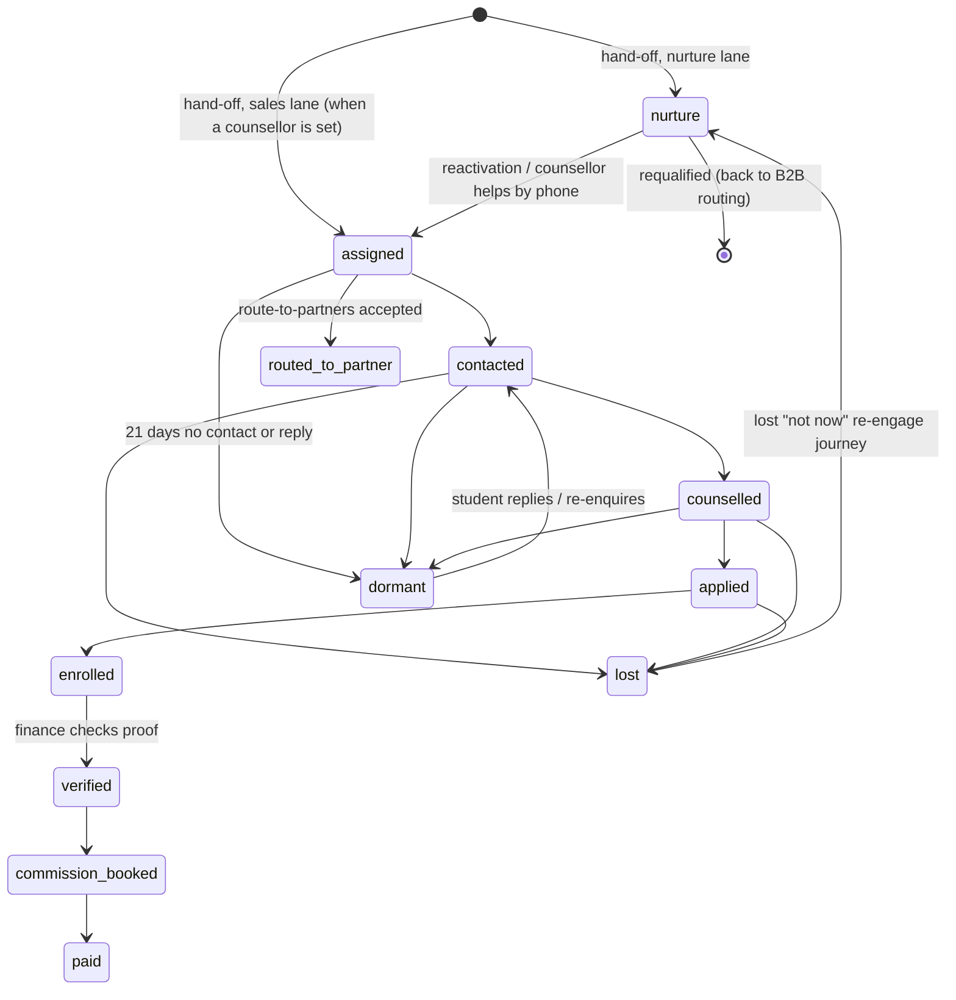

# Eduwit B2C CRM: design

Version 0.1 · 14 October 2026 · Status: **superseded** by the final spec `b2c-crm/docs/B2C_CRM_PROMPT.md` and the Phase 0
audit `b2c-crm/docs/phase0-audit.md` (14 Oct). Kept for reference only; where they differ, they win.

Inputs: `docs/b2c-contract.md` (the integration contract, version 3: **the B2C CRM's hard boundary**),
`docs/B2B_CRM_ADDENDUM_1.md` and `_3.md` (why leads reach B2C and what B2C must do with them), `docs/b2b-design.md`
(the B2B CRM's architecture, which this design mirrors), `docs/phase0-audit.md` §4.6–4.7 (the old objects left to B2C),
and the old CRM (`connect289/eduwit-crm`: `crm/sql` 002–007, `crm/web`, `CLAUDE.md`), which still runs the B2C features
today at `eduwit-crm.vercel.app`.

`B2C_CRM_PROMPT.md`, named in Addendum 1, is not in either repository. Where this design needed a product decision that
the prompt would have held, it proposes one and lists it in section 0.3.

---

## 0. Decisions

### 0.1 Fixed by the contract (not open)

- **The B2B CRM decides where every lead goes.** The B2C CRM never routes, never sets `allocation`, and moves a lead to
  partners only through `POST /v1/leads/{id}/route-to-partners` (contract §3.2), never for a partner-barred lead.
- **No direct access to the lead table.** The B2C CRM reads and writes no `public.student_leads` and no `b2b.*` table. It
  keeps its own copy of the leads (webhooks plus the change feed) and writes back only through the API (contract §2–3).
- **Consent is recorded by B2B.** The B2C CRM sends the one-tap request and reports the send and the answer (contract §1.3, §4).
  It stores no consent of its own.
- **B2C messages students from its own WhatsApp number**, never Witty's. B2B sends nothing for B2C leads
  (`b2c_sends_own_notification = true`).
- **Phone is identity.** The B2C CRM never changes `student.phone`; new students go in through the Intake API with
  `lead_source` `b2c_created` or `b2c_whatsapp`, after a lookup.
- **Test leads** (`test: true`, phones `910000…` / `9190000000NN`) never reach a counsellor queue, a report or a real send.

### 0.2 Proposed choices

| # | Choice |
| --- | --- |
| C1 | **Code in `b2c-crm/` in this repository**, next to `b2b-crm/`, with the same stack: Next.js (App Router, React 19, Tailwind 4, Geist, lucide, sonner, zod), Supabase, Vitest, Vercel region `bom1`. Shared look: navy `#0B2F5E` and amber `#F5A800` |
| C2 | **Own Supabase project** (`eduwit-b2c`, Mumbai), own schema `b2c`, own Auth. Its service key can then never touch `student_leads`, so contract §5 holds by construction, not by discipline. Fallback if a second project is refused on cost: schema `b2c` in the production project, with a dedicated Postgres role that has no grant on `public` or `b2b` (see 0.3) |
| C3 | **Timers and queues inside Postgres**, as in B2B (D14): `pgmq` + `pg_cron` + `pg_net` call `/api/internal/*` on the app with `x-internal-key`. No n8n workflow in the B2C path |
| C4 | **WhatsApp through Meta's Cloud API directly**, on a new B2C number, sending templates and receiving the webhook in the app. Chatwoot is optional, as a read-only mirror (see 0.3) |
| C5 | **Calls through Exotel click-to-call**, reusing the old CRM's `lib/comms/exotel.ts` and its call-outcome → next-task logic. Manual call logging always works without a dialer |
| C6 | **Email through Resend or Brevo's HTTP API**, as in B2B (pg_net speaks HTTP only), Reply-To the counsellor |
| C7 | **Roles carried over from the old CRM**, trimmed to what B2C does (section 3). Staff sign in with Google Workspace (`@eduwit.in`) or email plus TOTP |
| C8 | **The B2C money ledger stays in B2C** (Addendum 1 §5): university commission rates, enrolments, earnings, invoices and counsellor payouts in schema `b2c`. Enrolment fields go to B2B through `PATCH` (contract §3.4), so the Master Lead Table shows them |
| C9 | **Greenfield data.** All leads were wiped on 5 Oct and `crm_users` holds 4 rows, so nothing needs migrating except the starter journeys, templates and settings, which are re-created |

### 0.3 Needs your answer

These block go-live, not building:

1. **Separate Supabase project (C2).** A second project in the production organisation costs about $10 a month of
   compute on the Pro plan. Yes, or the same-project fallback?
2. **The B2C WhatsApp number (C4).** Which number, and on which Meta Business Account (WABA)? Templates are approved per
   WABA. Should replies also show in Chatwoot (a second inbox), or only in the B2C CRM's own inbox?
3. **Templates to submit to Meta** (section 7.2). The partner-consent text `wa_partner_consent:v1` must match the
   registered text word for word, and the consent text needs your lawyer's approval (already open on the B2B side).
4. **Counsellor policy for `counsellor_choice` leads** (section 4.3). Proposal: they wait in a Sales pool that
   counsellors claim from, and anything unclaimed after 15 working minutes is assigned by round robin.
5. **First-contact SLAs** (section 4.4): 15 working minutes for `round_robin_now`, 2 working hours for other sales
   leads. Working hours 09:00–20:00 IST, Monday to Saturday?
6. **Payout rules** for counsellors (old CRM: % of fee, % of Eduwit's earning, or fixed, with accelerators). Keep as is?
7. **Witty change** (open on B2B too, Addendum 1 §4b): Witty should stop chatting only when a B2C counsellor is assigned
   (`owner_user_id` set), not when the lead is merely handed to B2C. Until it changes, Witty stops for every B2C lead,
   including qualification nurture, where Witty is meant to keep qualifying.

---

## 1. What the B2C CRM is

Eduwit's in-house sales and nurture CRM. It works only the leads the B2B engine gives it, and does three jobs, named by
`handling.job` on every hand-off:

| Job | Lane | Goal | Done when |
| --- | --- | --- | --- |
| **sell** | sales | A counsellor sells an Eduwit-served programme | enrolled, or lost |
| **qualify** | nurture | Collect only the missing details (`missing[]`) or the partner-sharing consent, so the lead can return to partner routing | `b2c.lead_requalified` (the lead goes back to B2B and usually on to a partner) |
| **nurture** | nurture | Keep a partner-lost student warm with timed messages, without a counsellor | `b2c.lead_reenquired` with `reactivation: true` (a counsellor is assigned and the job becomes sell), or opt-out |

What it is **not**: a router, a partner tool, a consent register or a copy of Witty. It never competes with partners
and never sells a lead that a partner holds.

### 1.1 What changes from the old CRM

| Old CRM (`eduwit-crm`) | New B2C CRM |
| --- | --- |
| Reads and writes `student_leads` directly | Own copy of the leads, rebuilt from the change feed; writes through the API |
| Round robin on `is_sales_ready` (`crm_auto_assign`, now disabled) | Assignment from the hand-off's `handling.assignment` (section 4.3). `crm_auto_assign` stays disabled and is dropped at cut-over |
| In-house team competes with partners (Thompson sampling) | Fallback only; no engine |
| WhatsApp through Chatwoot on Witty's number | Own B2C number on Meta's Cloud API |
| Partners, engine and partner events screens | Gone (they belong to B2B) |
| Journeys triggered on any lead field | Journeys keyed to the lane and job, and exit on the contract's events (section 7.3) |
| One `stages` list mixing partner and in-house stages | The B2C stage keys from `GET /v1/b2c/schema`, plus B2C-only sub-stages |

**Reused from the old CRM** (logic and code, re-pointed at the local copy): Supabase SSR auth wiring; `exotel.ts`,
`msg91.ts`, `email.ts`; call-outcome → suggested task; the follow-up tick (reminders, overdue, escalation, SLA breach);
`crm_agenda`; segment rule evaluator (`crm_rules_where`); journey runner (steps: send, wait, task, update, branch, goto,
exit); lead scoring (fit + decaying engagement); marketing guardrails; unsubscribe tokens; money functions
(`crm_compute_payout`, payout runs, period close); the kanban and lead page layouts; the PWA manifest.

---

## 2. Architecture

```
                          B2B CRM (Vercel + Supabase prod)
   signed webhooks b2c.* / b2b.*   │   ▲  PATCH /v1/b2c/leads/{id}, /batch, /activities
   GET /v1/handoffs, /v1/b2c/leads │   │  POST /v1/leads/{id}/route-to-partners, POST /v1/leads (intake)
                                   ▼   │  POST /v1/events/b2ccrm (signed: consent, opt-out, erasure)
 ┌──────────────────────────── B2C CRM (b2c-crm/web on Vercel) ────────────────────────────┐
 │ /api/b2b/webhook ── verify HMAC ── b2c.inbound_events (dedupe on envelope id) ── 200    │
 │                                                     │ pgmq 'apply'                        │
 │                                                     ▼                                     │
 │      b2c.apply_envelope()  → b2c.leads (copy, by version) → b2c.holds → assignment,       │
 │                               journeys, consent sends, tasks, notifications                │
 │ pg_cron 1 min  → /api/internal/drain : outbound writes (urgent now, the rest every 15 min) │
 │ pg_cron 5 min  → /api/internal/reconcile : GET /v1/handoffs?after, /v1/b2c/leads?after    │
 │ pg_cron 1 min  → /api/internal/tick : SLA clocks, reminders, journeys, sends, scoring      │
 │ /api/whatsapp/webhook (Meta) ── b2c.messages ── consent answers, replies, new students     │
 │ /api/telephony/exotel ── b2c.calls                                                        │
 │ Staff (counsellors, heads, marketing, finance) ──► UI ──► server actions ──► b2c.* SQL    │
 └───────────────────────────────────────────────────────────────────────────────────────────┘
                         Supabase project eduwit-b2c (schema b2c)
```

- **Store first, work after.** The webhook handler verifies the signature, inserts the raw envelope (unique on `id`)
  and answers `200` within the 10-second budget. Applying it happens in a job, so a slow step never causes a retry storm.
- **The copy is the read model.** Every screen reads `b2c.leads`. Writes go to `b2c.outbound_writes` first, are shown as
  *pending* on the lead, and become real when the echo (`origin: "b2c:<request_id>"`) or the API answer brings the new
  `version`.
- **Two safety nets.** `GET /v1/handoffs?after=` catches missed hand-off events; `GET /v1/b2c/leads?after=` catches
  missed record changes. Both cursors are stored. A full rebuild is `after=0`.
- **Failure isolation.** If B2B is down, writes queue and retry (the `request_id` makes them safe). If the B2C app is
  down, B2B retries for about 10 hours and the feed covers the rest.
- **Code layout:**

  ```
  b2c-crm/
    supabase/migrations/   tracked SQL (staging first, then production)
    supabase/tests/        pgTAP
    web/                   Next.js: UI, /api/b2b/webhook, /api/whatsapp/webhook, /api/telephony/*, /api/internal/*
      lib/b2b/             contract client: signing, schema cache, feed, writes, events (typed from GET /v1/b2c/schema)
      lib/comms/           whatsapp-cloud, exotel, email, msg91
    mock-b2b/              a fake B2B CRM that plays contract §6's eleven checks, for end-to-end tests
  ```

---

## 3. Roles and permissions

### 3.1 People

| Role | Sees | Can |
| --- | --- | --- |
| `admin` | Everything, including test leads | Everything: users, settings, templates, the B2B link, money approvals |
| `sales_head` | All held leads | Assign and reassign, claim for others, stages, route-to-partners, team caps and shifts, merge, reports |
| `team_lead` | Their team's leads plus the pools | As a counsellor, plus reassign inside the team |
| `counsellor` | Own leads, the Sales pool, the Nurture desk | Claim, call, message, notes, tasks, stages, lost, enrolment, route-to-partners on own leads |
| `marketing` | All leads, phone and email masked | Segments, journeys, campaigns, templates, scoring rules |
| `finance` | Enrolments and money, masked contact | Verify enrolments, rates, payout runs, invoices |
| `viewer` | All leads, masked | Read only |

- `b2c.app_users` (`user_id` = Auth id, `email`, `role`, `team_id`, `is_active`, `phone` for click-to-call, `languages[]`,
  `courses[]` skills, `daily_new_cap`, `open_cap`, `monthly_target`, `shift` (weekly hours), `on_leave_until`).
- A new sign-in lands inactive; an admin activates it on **Team**. `connect@eduwit.in` is seeded as admin.
- `b2c.can(permission)` is checked in every server action and SQL function, not only in middleware.
- Leads with `held_by_b2c: false` (scope *all*) are **read-only for everyone**, and show "With a partner: do not contact".

### 3.2 System actors

| Actor | Authenticates with | May do |
| --- | --- | --- |
| `b2b` | HMAC on `/api/b2b/webhook` (the signing secret, in Vault) | Deliver envelopes |
| `worker` | `x-internal-key` on `/api/internal/*` | Claim jobs, call B2B, Meta, Exotel and email, record results |
| `meta` | `X-Hub-Signature-256` with the app secret on `/api/whatsapp/webhook` | Deliver messages and statuses |
| `exotel` | Webhook key on `/api/telephony/exotel` | Call status callbacks |
| `journeys` / `scoring` / `assigner` | Run inside SQL functions | Their own writes, each logged as the actor |

Secrets (B2B signing secret, B2B API key with scopes `b2c`, `events`, `intake`, Meta token and app secret, Exotel, email,
internal key) live in Vault or Vercel's encrypted env, never in a table column or a log.

### 3.3 Database privileges

Every `b2c` table has RLS on; reads through `(select b2c.can(...))`; no insert, update or delete policies; all writes
through `SECURITY DEFINER` functions with `search_path = ''`. Contact fields are masked by a view for roles without
`contact.read`. Every write records `actor_type` and `actor_id`.

---

## 4. Lead lifecycle in the B2C CRM

### 4.1 From hand-off to queue

When a `b2c.lead_handed_off` envelope is applied, the CRM opens a **hold** (`b2c.holds`: one per allocation) and acts on
`handling`:

| `reason` | Lane / job | Queue it lands in | Assignment | Automatic actions |
| --- | --- | --- | --- | --- |
| `duplicate_cascade`, `partner_barred` (bar `duplicate`) | sales / sell | Counsellor's **My leads** | **Round robin now** | Neutral-adviser script card; "Already with other providers" badge; route-to-partners hidden |
| `partner_barred` (bar `lost`) | sales / sell | My leads | Round robin now | Standard script; route-to-partners hidden |
| `b2c_created`, `no_partner_consent`, `no_partner_offers_programme`, `no_capacity`, `partners_unreachable`, `partner_attempts_exhausted`, `b2c_held`, `rule`/`import_choice`/`manual` (sales), `test_handoff` | sales / sell | **Sales pool** | Counsellor choice: claim, else round robin after 15 working min (0.3 #4) | Counsellor-intro WhatsApp when assigned |
| `manual_route_failed` | sales / sell | Previous counsellor's My leads | `handling.previous_owner` (round robin if they are inactive or on leave) | Alert to that counsellor: "No partner took this lead" with `cause` |
| `not_qualified`, `rule`/`import_choice`/`manual` (nurture) | nurture / qualify | **Nurture desk → Qualifying** | Unassigned | `welcome_explore_programmes` if in `b2c_actions`; Qualification journey for `missing[]` |
| `consent_no_answer` | nurture / qualify | Nurture desk → Consent pending | Unassigned | Consent-repeat journey |
| `partner_lost` | nurture / nurture | Nurture desk → Partner-lost | **Unassigned until interest** | Partner-lost journey, first message at `nurture_first_message_at`, never earlier |

Other events:

| Event | What the CRM does |
| --- | --- |
| `b2c.lead_upserted` | Store the record if its `version` is higher than the copy's; refresh holds, badges, `missing[]`, consent state |
| `b2c.leads_batch` | Apply each entry like a single `lead_upserted` / `lead_released` |
| `b2c.lead_released` | Close the hold and its tasks, stop journeys and scheduled sends, keep the history read-only ("Released: merged / deleted / to partner") |
| `b2c.lead_reenquired` | Timeline item and a "Re-enquired" flag on the lead and in the owner's agenda. If `reactivation: true` and the lead has no owner: round robin now, job becomes sell, counsellor-intro message. Never forces an action otherwise |
| `b2c.lead_requalified` | Close the nurture hold, stop qualification and consent journeys, show "Back to partner routing". If a new `lead_handed_off` follows, it opens a new hold |
| `b2c.lead_reengaged` | Flag on the Nurture desk with the still-missing details; creates an optional "Help qualify by phone" task, at most one a day |
| `b2c.consent_requested` | Queue the consent template send (section 7.4) |
| `b2c.consent_closed` | Close the consent request; cancel a queued send if `cancelled` |
| `b2b.lead_routed_to_partner` | Close the pipeline: stage `routed_to_partner`, hold closed, journeys and tasks stopped |
| `b2c.lead_flagged`, `b2c.lead_close_agreed` | Alert to the owner (or sales heads if unowned) |
| `ping` | Recorded; shown as green on **B2B link** |

### 4.2 Stages

`stage` must be a key from `GET /v1/b2c/schema`. The B2C CRM uses these keys (the B2B list marks `nurture`, `assigned`,
`dormant`, `routed_to_partner` as `held_by_b2c`; the funnel keys are shared):



- A sales-lane lead waiting in the Sales pool keeps the stage B2B gave it until a counsellor is set; assignment writes
  `stage: assigned`, `owner_user_id`, `assigned_at`, `team_id` in one `PATCH`.
- Sub-stages reuse the old CRM's list (`contacted`: no answer, busy, switched off, call-back scheduled, connected
  interested, connected not now; `counselled`: considering, comparing options, parent to decide, documents pending; …)
  and add `nurture`: qualifying, consent pending, partner-lost, long-term.
- Lost reasons are B2B's list (`not reachable`, `not interested`, `not eligible`, `over budget`, `chose another provider`,
  `enrolled elsewhere`, `duplicate`, `junk or test`, `wrong number`, `cannot be served`) plus `not now`, if B2B adds it.
- Moving to `enrolled` requires programme, university, fee amount and enrolment date (the old CRM's required fields).

### 4.3 Assignment

`b2c.assign(lead, mode)` is the only writer of the owner.

- **Eligible counsellor:** active; role counsellor or team lead; on shift now (or within the next 30 minutes); not on
  leave; under `daily_new_cap` and `open_cap`; speaks the student's `preferred_language` if set; has the course skill if
  any counsellor does (otherwise everyone).
- **Round robin:** the eligible counsellor with the oldest `last_assigned_at`, with a row lock so two hand-offs never
  pick the same person twice in a race.
- **Nobody eligible:** the lead waits in the Sales pool with "No counsellor available", and sales heads get an alert. It
  is assigned at the next shift start.
- **Claim:** a counsellor claims from the Sales pool (subject to the same caps). A sales head can assign anyone.
- **Write-back:** `PATCH` with `owner_user_id`, `team_id`, `assigned_at`, `stage: assigned`, sent at once (urgent), plus
  a WhatsApp counsellor-intro message from the B2C number.

### 4.4 Follow-up discipline

Ported from the old CRM's `007_crm_followup.sql`, re-pointed at the copy:

- **First-contact SLA clock** per hold, in working hours: `round_robin_now` 15 minutes, other sales 2 hours (0.3 #5).
  At-risk alert at 75%, breach alert to owner and team lead, and a second breach escalates to the sales head.
- **Tasks:** every call outcome suggests the next task (connected → call tomorrow, call back → in 2 h, no answer → retry
  in 3 h, three no-answers in 48 h → WhatsApp template, wrong number → verify). One suggested task per lead.
- **Reminders** 10 minutes before a task, overdue alerts, escalation after 2 hours overdue.
- **Untouched 48 h** list and **dormant sweep** (21 days with no contact or reply → stage `dormant`, enters the
  long-term journey).
- **Daily digest** at 08:00 IST per counsellor and per head.

### 4.5 Route to partners

Shown on a held sales lead only when `allocation.partner_bar_reason` is null **and** `consent.state` is `given`. If
consent is missing the button reads "Ask for partner consent first" (the Admin's request, contract §1.3). A reason of 3–300
characters is required. The CRM calls `POST /v1/leads/{id}/route-to-partners` and shows "Being sent to a partner";
the pipeline closes only on `b2b.lead_routed_to_partner`. A `422` shows its `error_code` in plain words; `in_house` or a
later `manual_route_failed` returns the lead to the same counsellor.

---

## 5. Data model (schema `b2c`)

Conventions as in B2B: `bigint` identity keys, `timestamptz`, `created_at` everywhere, `updated_at` + actor columns on
mutable rows, money `numeric(12,2)`, no deletes of money or audit rows.

### 5.1 Access, settings, audit

| Table | Key columns |
| --- | --- |
| `app_users`, `teams`, `sign_in_log` | Section 3.1 |
| `settings`, `settings_versions` | `key`, `value jsonb`, `version`; keys: `working_hours`, `sla`, `assignment`, `quiet_hours`, `marketing_limits`, `scoring`, `dormant_days`, `sync` |
| `events` | Append-only: every apply, assignment, write, send, alert. Source for timelines and audit |
| `alerts` | In-app notifications (bell), per user, with read state |

### 5.2 The copy of the leads (contract §2)

| Table | Key columns |
| --- | --- |
| `leads` | `id` (= `student_leads.id`), `version`, `seq`, `record jsonb` (verbatim), `held_by_b2c`, `is_test`, `deleted`, `merged_into_id`, `applied_at`, plus **generated columns** for filtering: `name`, `phone`, `email`, `city`, `course`, `programme_level`, `study_mode`, `stage`, `sub_stage`, `owner_user_id`, `team_id`, `lane`, `reason`, `job`, `hold_kind`, `partner_bar_reason`, `consent_state`, `qualification_class`, `missing text[]`, `lead_score`, `temperature`, `last_activity_at`, `nurture_first_message_at` |
| `inbound_events` | Envelope `id` (unique), `type`, `lead_id`, `occurred_at`, `delivery`, `raw`, `status` (stored, applied, ignored, error), `error`. One de-duplication table for webhooks and `GET /v1/handoffs` |
| `sync_cursors` | `handoffs_after`, `feed_after`, `last_full_rebuild_at`, `schema_version`, cached `GET /v1/b2c/schema` |
| `holds` | One per B2C allocation: `allocation_id`, `lead_id`, `lane`, `reason`, `cause`, `job`, `assignment`, `script`, `opened_at`, `closed_at`, `closed_by` (requalified, released, routed_to_partner, enrolled, lost), `handoff` (the full §1.2 payload) |
| `outbound_writes` | `request_id` (unique), `lead_id`, `op` (update, activity), `body`, `if_version`, `urgent`, `status` (queued, sent, applied, conflict, refused, failed), `attempts`, `answer`, `actor`. Drained at once when urgent, otherwise in `POST /v1/b2c/leads/batch` every 15 minutes |
| `outbound_events` | Signed events to `POST /v1/events/b2ccrm`: `event_id` (unique), `type`, `data`, `status`, `answer` |
| `lead_overlays` | Local-only fields that B2B does not carry (preferred call time, parent's name and phone, notes pinned to the top). Never sent |

**Version rule:** `b2c.apply_record(lead_id, version, seq, record)` writes only when `version > leads.version`. Holds,
journeys and badges are derived after each apply.

### 5.3 Work

| Table | Key columns |
| --- | --- |
| `tasks` | `lead_id`, `owner_id`, `kind` (call, whatsapp, email, meeting, todo), `title`, `due_at`, `status`, `suggested`, `source` |
| `notes` | `lead_id`, `body`, `pinned`, actor; also posted to B2B as `note` activities |
| `calls` | Exotel `sid`, `direction`, `from`, `to`, `status`, `duration_s`, `recording_url`, `outcome`, `lead_id`, `user_id`. Each finished call becomes a `call` activity to B2B |
| `sla_clocks` | `hold_id`, `kind` (first_contact), `started_at`, `due_at`, `met_at`, `state` |
| `saved_views` | Per user filters and columns |

### 5.4 Messaging

| Table | Key columns |
| --- | --- |
| `wa_numbers` | The B2C number(s): `phone_number_id`, `waba_id`, display number |
| `conversations` | One per student phone: `lead_id` (nullable for unknown numbers), `last_inbound_at` (the 24-hour window), `assigned_to`, `unread` |
| `messages` | `wamid` (unique), `direction`, `type` (text, template, button, media), `body`, `template_name`, `status` (queued, sent, delivered, read, failed), `error`, `lead_id`, `user_id` |
| `templates` | `channel`, `name` (Meta name), `language`, `category`, `body`, `variables`, `status` (draft, submitted, approved, rejected), `purpose` (welcome, consent, intro, nurture, …) |
| `consent_requests` | Mirror of B2B's request: `request_id`, `lead_id`, `context`, `text`, `text_version`, `expires_at`, `send_wamid`, `sent_at`, `reported_sent_at`, `answer`, `answer_wamid`, `answered_at`, `reported_at`, `status` |
| `email_sends` | Provider id, status, opens and clicks later |
| `unsubscribes` | `lead_id`, `channel`, `at`, `source` |

### 5.5 Marketing

`segments`, `segment_members`, `campaigns`, `campaign_sends`, `journeys`, `journey_runs`, `scoring_rules`: the old CRM's
shapes (006), with three changes: rules read `b2c.leads` columns; every journey declares the `lane`/`job` it serves;
`journey_runs.exit_reason` includes `requalified`, `released`, `routed_to_partner`, `assigned`, `opted_out`.

### 5.6 Money (C8)

| Table | Key columns |
| --- | --- |
| `university_settings` | Refund window, invoicing details per university |
| `earning_rates`, `payout_rates` | Versioned by date (old CRM 003) |
| `enrolments` | `lead_id`, `hold_id`, `university`, `programme`, `fee_inr`, `enrolled_on`, `proof_path`, `status` (reported, verified, refunded, cancelled), `verified_by` |
| `earnings`, `payouts` | Lines, never deleted; reversals by `reverses_id` |
| `payout_runs`, `invoices`, `receipts` | As in the old CRM |

When an enrolment is reported, the CRM writes the enrolment group to B2B (`enrollment_status`, `enrolled_program`,
`enrollment_date`, `expected_net_revenue_inr`), and again on verification and refund.

---

## 6. The B2B link (contract implementation)

| Contract item | Implemented by |
| --- | --- |
| §1 webhooks | `POST /api/b2b/webhook`: raw body, constant-time HMAC over `<timestamp>.<raw body>`, ±300 s, insert into `inbound_events` (conflict on `id` → `200`), `200` in under a second, enqueue `apply` |
| §2.3 change feed | `/api/internal/reconcile` every 5 min: `GET /v1/b2c/leads?after=<feed_after>&limit=500` until empty; first build from `after=0` |
| §3.1 hand-off feed | Same job: `GET /v1/handoffs?after=<handoffs_after>`; envelopes go through the same de-duplication |
| §3.3 lookup | Before creating a student (walk-in, call, unknown WhatsApp number) |
| §3.4 / §3.8 writes | `outbound_writes`: urgent (owner, stage, lost, enrolment, other_courses on a nurture lead) at once; the rest batched every 15 min. `409` stale → the lead shows "Changed by someone else", with the new record and a retry button. `422` → the refused fields are shown on the form |
| §3.5 activities | Every call, WhatsApp, SMS, email, meeting and note, batched |
| §3.6 intake | `POST /v1/leads` with `lead_source` `b2c_created` / `b2c_whatsapp`, `other_courses`, and `consent_text_version` only for a registered text |
| §3.7 schema | Read at start-up and hourly; the forms, stage list, enums and the writable flag on every field come from it. A field the Admin made read-only greys out |
| §4 events | `outbound_events`, signed with the same secret: `consent_request_sent`, `partner_consent`, `opted_out`, `erasure_requested` |
| Sync cadence | Reads `delivery` and `interval_minutes` from the schema and shows them on **B2B link** |

**B2B link screen** (admin): last delivery and its signature result, events by type today, apply errors, feed lag (our
`seq` vs the newest), queued and refused writes, conflicts, the consent send log, and a "Rebuild copy" button.

---

## 7. Messaging

### 7.1 Guardrails (every outbound message)

- Never to a test lead, an opted-out student, a lead with `held_by_b2c: false`, or a released lead.
- WhatsApp free text only within 24 hours of the student's last inbound message to **this** number; otherwise an
  approved template.
- Quiet hours 09:00–20:00 IST for marketing and nurture (a counsellor's one-to-one message is allowed 08:00–21:00).
- At most 1 marketing WhatsApp a day and 6 in 30 days, 2 emails a day (old CRM limits); consent and intro messages do
  not count toward them.
- No marketing send while a Witty chat is live (last Witty message under 30 minutes ago, from the record).

### 7.2 Templates to register with Meta

| Name | Purpose | When |
| --- | --- | --- |
| `explore_programmes` | Amendment 1.2 welcome: "explore programmes to enhance your career" with a link | `b2c_actions` contains `welcome_explore_programmes` |
| `wa_partner_consent_v1` | The PART 7.2 sentence, with **YES / NO quick-reply buttons** | `b2c.consent_requested` and the consent-repeat journey |
| `counsellor_intro` | "{{counsellor}} from Eduwit will call you about {{programme}}" | Every assignment (Addendum 1: B2C messages the student every time it assigns) |
| `neutral_adviser_intro` | "Eduwit can help you compare options for {{programme}}" | Duplicate-cascade assignment |
| `missing_details` | Ask for the first missing item (name, email, course) | Qualification journey |
| `nurture_checkin`, `reengage_60d`, `monthly_update`, `deadline_3d`, `deadline_1d`, `fee_followup` | Journeys | Section 7.3 |

### 7.3 Journeys (re-created starters)

| Journey | Trigger | Steps (summary) | Exits |
| --- | --- | --- | --- |
| **Q1 Qualify** | Hold `not_qualified` | Welcome (if asked) → wait 1 day → `missing_details` → wait 2 days → email ask → wait 3 days → optional counsellor task | requalified, released, opt-out, reply (a counsellor picks up the chat) |
| **Q2 Consent repeat** | Hold `consent_no_answer` | Day 2, 5 and 10: re-send `wa_partner_consent_v1` (each through a new request from B2B, or the Admin's; see 7.4) | consent closed answered, requalified |
| **L1 Partner-lost** | Hold `partner_lost` | Wait until `nurture_first_message_at` → `nurture_checkin` → every 30 days for 6 months | reactivation, opt-out |
| **S1 No answer** | Assigned 1 day, no contact | WhatsApp → wait 2 days → email → task "call at a different time" | contacted |
| **S2 Fee concern**, **S3 Deadline countdown** | Manual from the lead page | As in the old CRM | stage moves on |
| **D1 Dormant / lost "not now"** | Stage `dormant`, or lost with "not now" after 60 days | `reengage_60d` → monthly update ×12 | reply, re-enquired |

### 7.4 Consent flow (contract §1.3)

1. `b2c.consent_requested` arrives → a `consent_requests` row and a queued send of `wa_partner_consent_v1` with the
   programme filled in. The `text` must be the registered sentence; if B2B's `text` differs from the approved template,
   the send is held and the admin is alerted.
2. Meta accepts the send → `b2ccrm.consent_request_sent` `{request_id, sent_at, message_id}`.
3. The student taps **YES** or **NO** (button payload), or types it. Typed replies are matched against a short list
   (`yes`, `haan`, `ha`, `ok share` / `no`, `nahi`, `mat karo`). Anything else goes to the inbox as "Consent reply
   unclear" for a counsellor; nothing is reported.
4. A clear answer → `b2ccrm.partner_consent` `{lead_id, request_id, answer, answered_at, channel: "whatsapp",
   message_id: <the student's wamid>, text_version: "wa_partner_consent:v1"}`. A YES without the student's own
   `message_id` is never sent.
5. `b2c.consent_closed` closes the row. On YES the lead normally leaves (`b2b.lead_routed_to_partner`); on NO a
   `no_partner_consent` hand-off follows.

The Q2 journey asks again only through a fresh B2B request (it asks the Admin to request it from the lead's page, or
uses an API route if B2B adds one); the CRM never sends the consent template without a live `request_id`.

### 7.5 Inbound WhatsApp

- **Known lead held by B2C:** the message lands in the owner's inbox (or the Nurture desk), refreshes the 24-hour
  window, posts a `whatsapp` activity, and exits marketing journeys that end on reply.
- **Known lead not held by B2C:** an auto-reply with the support line and an alert. No selling.
- **Unknown number:** look up (§3.3); if new, an intake call with `lead_source: b2c_whatsapp`, and the conversation
  attaches when the hand-off arrives (`reason: b2c_created`).
- **STOP / "unsubscribe":** opt-out at once and `b2ccrm.opted_out`.

---

## 8. Scoring

Ported from the old CRM: fit points (rules on education, course, budget, timeline) plus engagement points (connected
calls, replies, form fills) halving every 14 days, capped at 100. Temperature: hot ≥ 70, warm ≥ 40, else cold, with
Witty's class as a floor. `lead_score` and `temperature` are written back to B2B (batched). B2B reads the score for
partner-lost reactivation (60+, contract §1 `reactivation`); the CRM assigns only on the `reactivation` flag, so the two
never both assign.

---

## 9. Screens

| Screen | For | What it shows |
| --- | --- | --- |
| **Today** | Everyone | Agenda (overdue, today, upcoming), SLA clocks at risk, new assignments, re-enquired leads, untouched 48 h |
| **Inbox** | Counsellors, heads | WhatsApp conversations, 24-hour window timer, templates picker, unclear consent replies |
| **Leads** | Everyone | Views: My leads, Sales pool, Nurture desk (Qualifying, Consent pending, Partner-lost), Re-enquired, Dormant, Enrolled, Lost, All (read-only partner leads under scope *all*); kanban by stage |
| **Lead page** | Everyone | Header badges: lane, job, reason, **partner bar**, **Already with other providers** (partner names and first-had dates), hold, consent state, test. Script card (standard / neutral adviser). Missing-details checklist for qualify leads. Student, education, interest (other courses editable), pipeline, application, enrolment. Timeline from B2B activities plus local calls and messages. Actions: call, WhatsApp, email, note, task, stage, lost, enrolment, route to partners (hidden when barred), opt-out, erasure request |
| **New student** | Counsellors | Phone first → lookup → intake |
| **Marketing** | Marketing | Segments, journeys, campaigns, templates (with Meta status), scoring rules |
| **Team** | Admin, heads | Users, roles, teams, shifts, caps, languages, skills, leave, round-robin order |
| **Money** | Finance, admin | Enrolments to verify, rates, payout runs, invoices, receipts |
| **Reports** | Heads, admin | Funnel by lane and reason, time to first contact, connect rate, SLA, counsellor leaderboard vs target, nurture → requalified rate, consent YES/NO/no-answer, partner-lost reactivation, enrolments and revenue |
| **B2B link** | Admin | Section 6 |
| **Settings** | Admin | Working hours, SLAs, quiet hours, limits, dormant days |

The app is a PWA, as the old CRM was, so counsellors can use it on their phones.

---

## 10. Privacy and erasure

- Contact fields are masked for roles without `contact.read`; exports are admin-only and logged.
- **Opt-out** (student or counsellor): local stop of every send and journey, then `b2ccrm.opted_out`.
- **Erasure:** `b2ccrm.erasure_requested`; the B2B Admin carries it out and the lead arrives as `b2c.lead_released`
  (anonymised). The CRM then deletes its local copies: messages' bodies, notes, overlays, call recordings links. Money
  lines keep only the lead id.
- Call recordings stay with Exotel; the CRM keeps the link only.

---

## 11. Migration plan

Every step is a file in `b2c-crm/supabase/migrations/`, applied to the B2C staging project first, then production.

| Step | What |
| --- | --- |
| **C0** | Project(s), schema `b2c`, `app_users`, `settings`, `events`, RLS helpers, auth (Google + email/TOTP), app shell, deploy to Vercel staging |
| **C1** | The copy: `inbound_events`, `leads`, `sync_cursors`, webhook endpoint, feed and hand-off reconciliation, schema cache, `mock-b2b`. **Acceptance:** contract §6 checks 1–3 against B2B staging |
| **C2** | Writes and holds: `outbound_writes`, `holds`, assignment, stage, lost, other courses, activities, batch. **Acceptance:** §6 checks 4–8 |
| **C3** | Lead page, Leads views, Sales pool, Nurture desk, Today, tasks, SLA clocks, alerts |
| **C4** | WhatsApp Cloud API (send, webhook, inbox), templates, welcome, counsellor intro, consent flow, opt-out. **Acceptance:** §6 checks 9–10 |
| **C5** | Route to partners, re-enquired, requalified, reengaged, released, routed-to-partner closures. **Acceptance:** §6 check 11 and Addendum 3 tests 1–4, 9, 10, 15 seen from the B2C side |
| **C6** | Exotel calls, email, journeys, campaigns, segments, scoring |
| **C7** | Money: enrolments, verification, rates, payouts, invoices; enrolment write-back |
| **C8** | Reports, digest, B2B link screen polish |

### 11.1 Cut-over from the old CRM (contract §5)

1. Build the copy from the feed (C1) while the old CRM keeps running.
2. Counsellors switch to the new app (C3–C4 done); the old app goes read-only.
3. All B2C writes go through the API (C2).
4. The B2C endpoint subscribes to `b2c.*` and `b2b.*`; the B2B Admin passes the go-live gate.
5. Remove the old CRM's database credentials; turn off the `eduwit-crm` Vercel project; archive n8n workflows
   `Wx1uai9qtOkwFQDs` and `UhSUqceTwQeuI5rR`.
6. With your approval: drop `crm_auto_assign` and the old `crm_*` B2C functions and tables from the production project
   (the B2B baseline keeps them in git). `/api/v1/verify/*` (website OTP) moves to the website agent or this app first.

---

## 12. Tests

- **pgTAP:** version rule (old version ignored, duplicate envelope ignored), hold opening per reason, assignment
  (caps, shifts, languages, race), SLA clocks in working hours, guardrails, journey exits on each closing event, money
  lines never deleted.
- **Vitest:** HMAC verify and sign (including a re-serialised body failing), schema-driven form validation, write
  batching and `409` / `422` handling, consent reply parsing, Meta webhook signature.
- **End to end against `mock-b2b`:** the eleven checks of contract §6, plus: a duplicate-cascade hand-off is assigned
  within a second with the neutral-adviser card and no route-to-partners button; a partner-lost lead gets no message
  before `nurture_first_message_at` and is assigned only on `reactivation: true`; a requalified lead's journeys stop;
  no send ever reaches a test phone.
