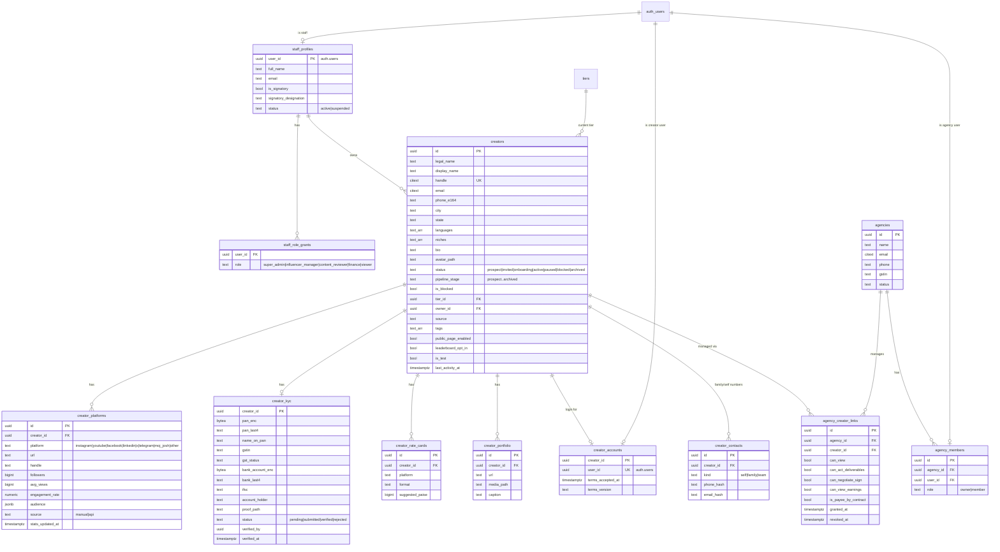
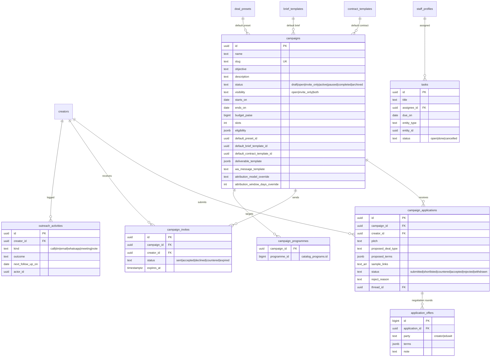
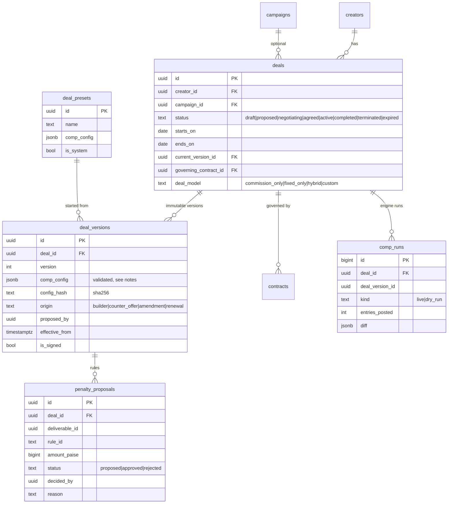
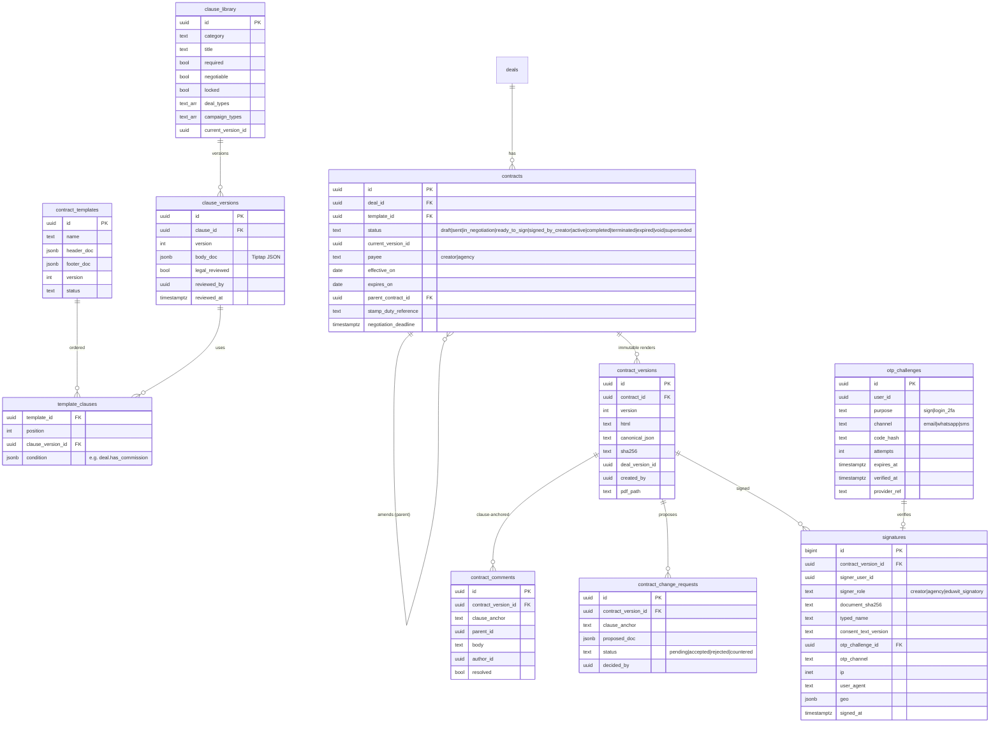
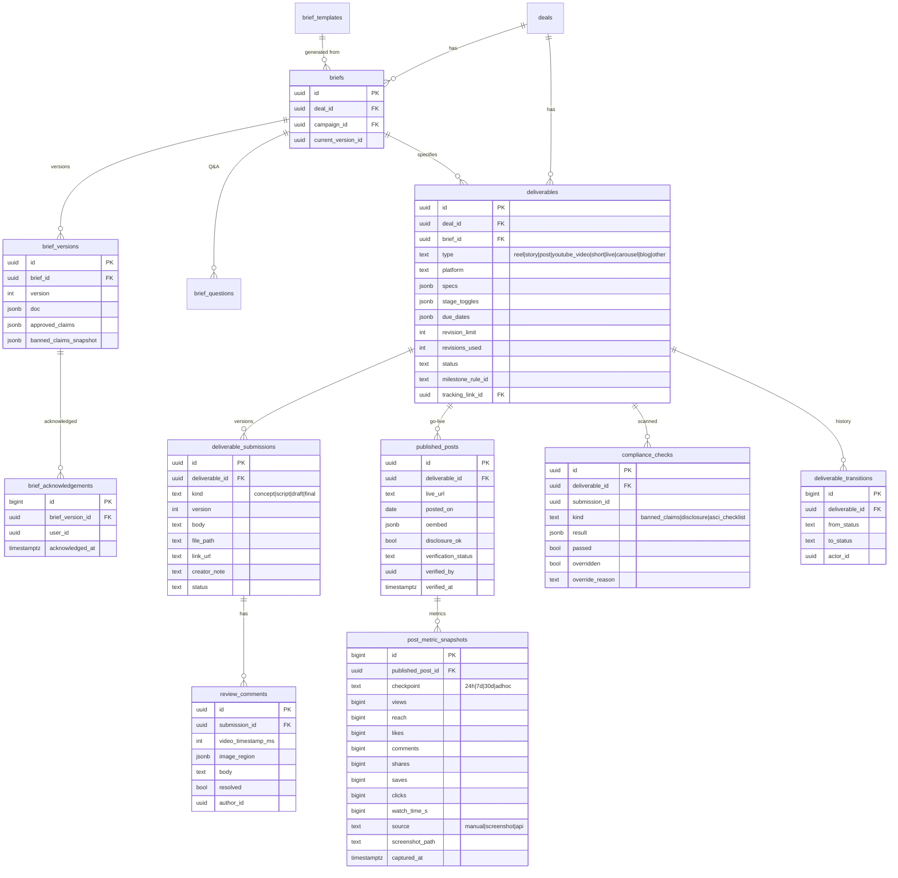
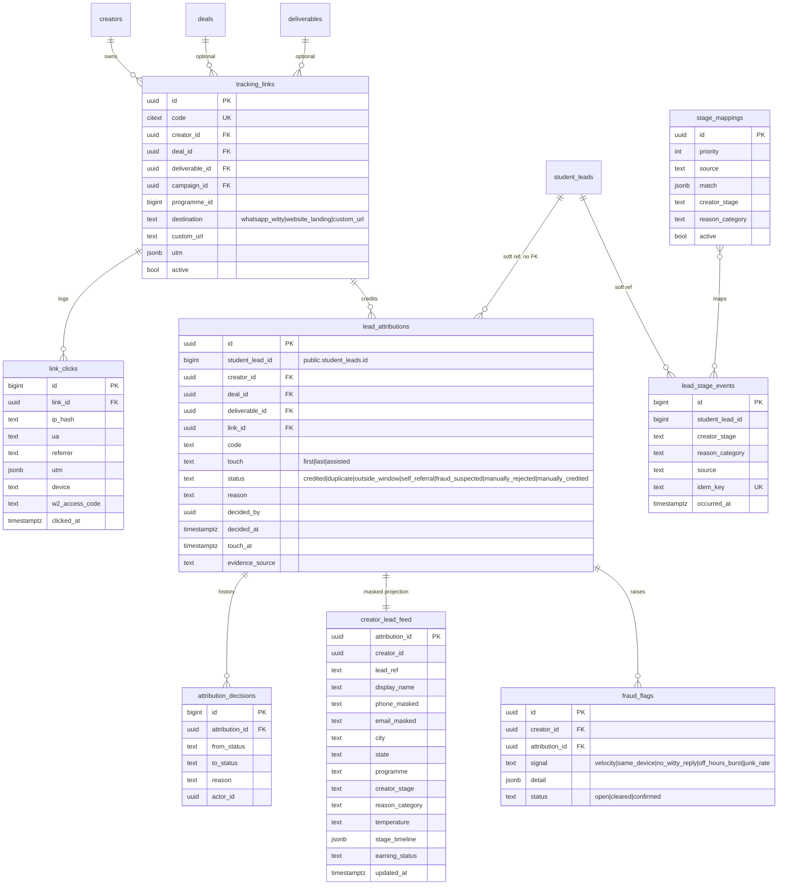
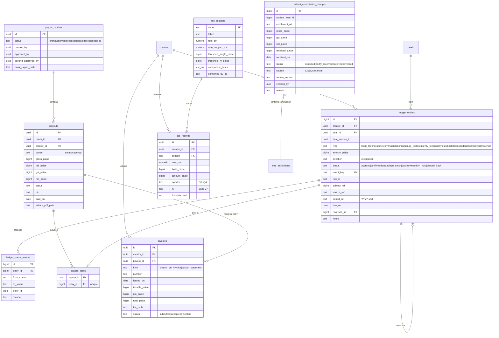

# Proposed data model (ERD)

Status: **proposal, waiting for owner approval** (Phase 0, HARD STOP 1). No migration is written until this is approved.

All tables live in schema **`inf`** (decision D-01; spec names map `inf_x` → `inf.x`). Conventions for every table:

- `id uuid primary key default gen_random_uuid()` (bigint identity for very high-volume logs: clicks, audit, events,
  ledger, stage events), `created_at timestamptz not null default now()`, `updated_at` where rows change, and
  `created_by uuid` (auth user) where a person creates the row.
- Money is `bigint` **paise**, suffix `_paise`. Times are `timestamptz` (UTC). IST is applied only in queries and the UI.
- Status columns are `text` with `check` constraints, so a new status is a one-line migration.
- RLS is on for every table. Policies call helpers as `(select inf.has_perm('…'))`, so they run once per statement.
  Writes go through `SECURITY DEFINER` functions; direct table writes are granted only where RLS fully covers them.
- Append-only tables (signatures, contract versions, ledger entries, audit log, stage events, deliveries) have a
  `before update or delete` trigger that raises, and no UPDATE/DELETE grant.
- `→ public.student_leads` means a soft reference by `student_lead_id bigint` **with no foreign key** to the shared
  table. A foreign key would add locking and `ON DELETE` coupling to the master table; integrity is checked by the
  sync job instead (decision D-07).

The diagrams below show keys and the columns that matter for relationships and logic. Full column lists come in the
Phase 1+ migrations.

## 1. Identity, roles, agencies

Notes:
- PAN and bank account numbers are encrypted with `pgp_sym_encrypt` using a key held in Vault (`inf_pii_key`), with
  `pan_last4`/`bank_last4` kept for masked display. Only `inf.kyc_reveal(creator_id)` decrypts, for the Finance role,
  and every call is audit-logged (D-08).
- `creator_contacts` stores **hashes** (HMAC with a Vault key) of the creator's own and family numbers and emails, for
  self-referral checks without keeping extra plain copies.

## 2. Prospecting, tasks, campaigns, applications

## 3. Deals and compensation

**Decision D-05: compensation config as validated JSONB, not child tables.** Each `deal_versions.comp_config` is one
immutable document (fixed components with milestone schedules, commission rules with scope, basis, slabs, caps,
floors, recoupment, accrual and confirmation, bonus rules with AND/OR conditions, penalty rules, additional fees, caps
and non-cash items), every element carrying a stable `rule_id`. Reasons:
1. The pure engine (`lib/compensation`) takes exactly this document as input, so the stored config and the tested
   input are the same thing (no mapping layer to drift).
2. Versions are snapshots. With ~10 child tables, each amendment would copy rows across all of them.
3. Validation runs twice: the zod schema in the app, and `inf.comp_config_valid(jsonb)` as a `check` constraint. The
   SQL check is **generated** from the zod schema (JSON Schema → a PL/pgSQL validator) by a build script, and a CI test
   fails if they drift.
4. Reporting needs ("which deals have retroactive slabs?") use a GIN index and the generated column
   `deal_model`.

## 4. Contracts and signatures

## 5. Briefs, deliverables, content review

## 6. Attribution and the creator lead pipeline

- `creator_lead_feed` is a **table** maintained by the sweep, holding only whitelisted, already-masked values. It is
  the only lead-shaped object creators can `SELECT` (RLS: `creator_id` is theirs, or an agency grant with `can_view`)
  and the only one in the Realtime publication. Raw lead data never reaches it.
- Uniqueness: one credited first-touch attribution per `student_lead_id` (partial unique index), so two creators can
  never both be paid for the same lead under first-touch; assisted rows are recorded separately.

## 7. Money

**Decision D-06: ledger immutability.** Financial columns (`amount_paise`, `type`, `direction`, `event_key`,
`creator_id`, `deal_id`, `rule_id`) can never change (a trigger raises). The lifecycle moves through
`ledger_status_events` (append-only), with `ledger_entries.status` kept as a denormalised current value that only the
`inf.ledger_transition()` function may change, and only along allowed edges (accrued → confirmed → payable → in_batch →
paid; any → on_hold; reversals and clawbacks are new entries). This keeps "corrections are new reversing entries" while
still letting a payout batch claim entries.

## 8. Engagement, configuration and operations

```mermaid
erDiagram
  threads ||--o{ messages : has
  messages ||--o{ message_reads : "read receipts"
  notification_templates ||--o{ notifications : renders
  notifications ||--o{ notification_deliveries : "per channel"
  creators ||--o{ scorecards : periodic
  tiers ||--o{ scorecards : "resulting tier"
  webhook_endpoints ||--o{ webhook_deliveries : logs
  domain_events ||--o{ webhook_deliveries : "fans out"
  domain_events ||--o{ jobs : triggers

  threads {
    uuid id PK
    text entity_type
    text entity_id
    text subject
    bool staff_only
  }
  messages {
    uuid id PK
    uuid thread_id FK
    uuid author_id
    text body
    text_arr attachment_paths
    uuid_arr mentions
    tsvector search
  }
  message_reads {
    uuid message_id FK
    uuid user_id
    timestamptz read_at
  }
  notifications {
    uuid id PK
    uuid user_id
    text event
    text title
    text body
    jsonb data
    bool mandatory
    timestamptz read_at
    text idem_key UK
  }
  notification_deliveries {
    bigint id PK
    uuid notification_id FK
    text channel "email|whatsapp|in_app"
    text status "queued|sent|failed|skipped"
    int attempts
    text provider_ref
    text error
  }
  notification_preferences {
    uuid user_id
    text event
    text channel
    bool enabled
  }
  notification_templates {
    uuid id PK
    text event
    text channel
    text locale
    int version
    text subject
    text body
    bool active
  }
  announcements {
    uuid id PK
    text title
    jsonb body
    jsonb segment
    timestamptz publish_at
  }
  tiers {
    uuid id PK
    text name
    int rank
    jsonb entry_rules
    jsonb benefits
  }
  scorecards {
    uuid id PK
    uuid creator_id FK
    text period
    jsonb metrics
    numeric composite
    uuid tier_id FK
  }
  banned_claims {
    uuid id PK
    text pattern
    text kind "phrase|regex"
    text severity
    text note
    bool active
  }
  settings {
    text key PK
    jsonb value
    int version
    uuid updated_by
    timestamptz updated_at
  }
  settings_versions {
    bigint id PK
    text key
    jsonb value
    int version
    uuid actor_id
    text reason
  }
  audit_log {
    bigint id PK
    uuid actor_id
    text actor_role
    text entity_type
    text entity_id
    text action
    jsonb before
    jsonb after
    inet ip
    text user_agent
    text request_id
    timestamptz at
  }
  domain_events {
    bigint id PK
    text type
    text subject_type
    text subject_id
    jsonb payload
    text idem_key UK
    timestamptz occurred_at
  }
  jobs {
    bigint id PK
    text kind
    jsonb payload
    text status "queued|running|done|failed|dead"
    int attempts
    timestamptz run_at
    text last_error
    text idem_key UK
  }
  webhook_endpoints {
    uuid id PK
    text url
    text_arr events
    uuid secret_id
    bool active
  }
  webhook_deliveries {
    bigint id PK
    uuid endpoint_id FK
    bigint event_id FK
    int attempt
    int status_code
    text error
    timestamptz next_attempt_at
  }
  sync_state {
    text key PK
    bigint last_id
    timestamptz last_ts
    timestamptz ran_at
    jsonb stats
  }
  email_codes {
    uuid id PK
    uuid user_id
    text code_hash
    int attempts
    timestamptz expires_at
  }
  trusted_devices {
    uuid id PK
    uuid user_id
    text token_hash
    text label
    timestamptz expires_at
    timestamptz revoked_at
  }
  dpdp_requests {
    uuid id PK
    uuid creator_id
    text kind "export|deletion"
    text status
    jsonb result
  }
  terms_versions {
    uuid id PK
    text kind "platform_terms|privacy|consent_otp|sign_consent"
    int version
    text body
    timestamptz effective_at
  }
  terms_acceptances {
    bigint id PK
    uuid user_id
    uuid terms_version_id FK
    inet ip
    timestamptz accepted_at
  }
```

## 9. Summary of decisions embodied here

| # | Decision | Where |
| --- | --- | --- |
| D-01 | Dedicated schema `inf` | All |
| D-05 | Compensation config as validated JSONB per immutable deal version | §3 |
| D-06 | Ledger: immutable amounts, status through an append-only lifecycle | §7 |
| D-07 | Soft references to `student_leads` (no foreign key) | §6, §7 |
| D-08 | PAN and bank encrypted with pgcrypto and a Vault key; last 4 stored for display | §1 |
| D-09 | Creator-safe masked projection table for Realtime and creator reads | §6 |
| D-10 | One credited first-touch attribution per lead (partial unique index) | §6 |
