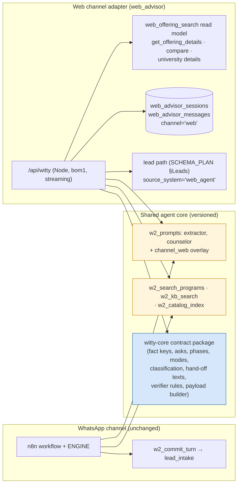

# Agent architecture — how the website's Witty (`web_advisor`) shares Witty's core

Source facts: `docs/discovery/witty.md` (how Witty works today, verified read-only on production 17 Oct 2026) and
`docs/discovery/witty-prompts.md` (verbatim prompts). Spec Sections 3A (Witty path) and 7.

## 1. What Witty is today (summary)
Witty 2.0 (live since ~5 Oct 2026) is a **deterministic pipeline**, not a free-form tool-calling agent:

```
inbound → SQL gates (w2_try_claim) → EXTRACTOR (LLM → facts+intents JSON, exact evidence)
       → ENGINE (JS: accept facts, eligibility, readiness, classification, phase, next ask, answer_mode, hand-off,
                 choose catalogue rows via w2_search_programs, knowledge via w2_kb_search)
       → COUNSELOR (LLM → one reply with {{P1.fee}} placeholders)  → code fills placeholders from rows
       → VERIFIER (code: unsourced claims, unverified numbers, length) → 1 rewrite or fixed fallback text
       → w2_commit_turn → w2_crm_payload → lead_intake()  (failures → w2_outbox)
```
Prompts: `w2_prompts` (`extractor` v6, `counselor` v6) assembled by `w2_build_prompt(name)`. Model: Gemini
`gemini-3.6-flash`. The ENGINE source (`witty2/project`) and the n8n workflow are **not readable** from this environment.

## 2. Principle
"Same brain" means: **same prompts (by reference, versioned), same catalogue and knowledge functions, same qualification
contract (fact keys, asks, phases, answer modes, classification enums, hand-off texts), same lead payload keys and event
types, same guardrails** — with only the channel adapter different (web renders cards and markdown; WhatsApp is text).

## 3. Architecture



### 3.1 The `witty-core` package (`web/lib/witty-core/`)
A channel-agnostic TypeScript module, written so that Witty's n8n build can adopt it (plain functions, no Next/React,
no n8n globals, JSON in/JSON out):
- `contract.ts` — exact enums from production: fact keys, ops, subjects, scales, confidence; asks (`ASK_NAME` … `NONE`);
  phases (`EARN_IT`, `QUALIFY_IT`, `ENRICH_IT`, `ESCALATION`, `SUPPORT`); answer modes; intents; classification
  (`UNQUALIFIED`, `HOT`, `WARM`, `COLD`, `PROGRAM_MISMATCH`, `JUNK`), readiness, eligibility; languages.
- `schemas.ts` — zod schemas for the extractor output, counselor input/output and the `lead_intake` payload (the
  `w2_crm_payload` key set, `docs/discovery/witty.md` §4.2 and §5).
- `engine.ts` — fact acceptance, eligibility against catalogue rows (min qualification, min %), readiness, classification,
  phase, next ask, answer mode, hand-off decision. **Implements Witty's contract as documented and observed on
  production** (witty.md §4.3–4.5). Every rule is in one table-driven file with a `source:` note (prompt text, W1
  fixture, observed data). Marked `contractVersion: "witty-2.0-observed-2026-10-17"`.
- `verifier.ts` — reply checks mirroring Witty's guardrails (no unsourced numbers, no programme/university/fee typed by
  the model, banned promise words, one question, length cap).
- `placeholders.ts` — `{{Pn.field}}` filling from catalogue rows (same field list as Witty).
- `fixed-texts.ts` — GREETING, consent line, HAND-OFF and OFFER_HANDOFF texts as used live (English + Hinglish).
- Unit tests ported from Witty's harness scenario names (`happy_path_mba`, `hinglish_parent`, `general_questions`,
  `fee_check_*`, `alternatives_and_complaints`) and the W1 ENGINE fixture.

**Identity guarantee.** The decision rules cannot be copied from Witty's ENGINE today (not readable). The package is
therefore labelled as an implementation of the *published contract* and is **verified against the real ENGINE before
`web_advisor_enabled` is switched on** (APPROVALS A-AGENT-1: supply the export / `witty2/project`; then either import
Witty's ENGINE into this package verbatim, or prove equivalence by replaying the harness and the 393 recorded
conversations' fact sequences). Until then the advisor ships **off** (spec 7.3 allows launch without it) and the hero
shows the guided finder + "Get free counselling".

### 3.2 Prompts by reference
- On cold start the route reads `w2_build_prompt('extractor')` / `w2_build_prompt('counselor')` through a website-owned
  read function `web_agent_core_prompts()` (SECURITY DEFINER, read-only, service role only), caches them in memory with
  `name:version:md5`, re-checks `w2_prompts.updated_at` every 5 minutes, and records the triple in
  `web_advisor_sessions.agent_core_version`.
- The web formatting overlay is **data**: proposed shared row `w2_prompts.name='channel_web'` (A-AGENT-3). Zero-approval
  fallback used in dev: the same versioned overlay in `web_settings.web_advisor_channel_overlay`. Witty never loads
  other prompt names (`w2_cache_plan` iterates only extractor/counselor), so neither option affects WhatsApp.
- Prompts are **not copied into this repo** (only the discovery appendix, as documentation).

### 3.3 Model
- Spec 3/7.3: **Claude API** with streaming and prompt caching. The website calls Claude (`claude-sonnet-5-5` for the
  counselor reply, `claude-haiku-5-5` for the extractor JSON; both set in `web_settings`, not code). Witty uses Gemini.
  The prompts and JSON contracts are model-neutral; a `ModelProvider` interface keeps a Gemini adapter possible if the
  owner wants byte-identical behaviour (DECISIONS D-011).

### 3.4 Tools (spec 7.3), all read-only and grounded
Witty does code-driven retrieval (the engine decides what to fetch; the LLM never calls tools). The web adapter keeps that
model for qualification and adds the spec's tools as **engine-invoked** functions, plus a constrained Claude tool-use
step only in `ANSWER` mode for follow-up questions on rows already shown:

| Spec tool | Implementation |
|---|---|
| `search_programmes` | `w2_search_programs` (same function Witty uses; the STABLE variant, so the website never writes Witty's cache) — results joined to `web_offering_search` by `catalog_programs.id` for card rendering |
| `get_offering_details` | `web_offering_details(id)` over the read model |
| `compare_offerings` | `web_compare_offerings(ids[])` |
| `check_eligibility` | `witty-core` `engine.eligibility()` over catalogue rows |
| `get_university_details` | `web_university_details(id)` |
| `save_lead_fields` | lead path below, through the outbox-backed lead writer |
| knowledge | `w2_kb_search` (same KB as Witty) |

The finder and Witty therefore always agree: both read `catalog_programs` (active rows) through the same mapping.

### 3.5 Storage
- **Not** `w2_messages` / `w2_conversations` at launch: `w2_conversations` is keyed by phone (a web chat would share the
  WhatsApp lock/state), and `w2_messages` has no channel column while six CRM functions compute WhatsApp's 24-hour
  service window from it (writing web turns there could trigger WhatsApp sends outside Meta's window). Writing there would
  break other products (spec rule 2.1), so:
- `web_advisor_sessions` (session, lead id, phone/email hashes for lookup, agent-core version, Witty-shaped `state` jsonb,
  classification/readiness/eligibility/phase, tokens, cost, timings) and `web_advisor_messages` with **exactly the
  `w2_messages` columns plus `channel='web'` and `session_id`**, so the rows can be moved into the shared table without
  transformation once A-AGENT-2/3 (channel column + channel-aware readers) are approved. A read-only union view is
  proposed for the CRM transcript screens.

### 3.6 Lead writes
`source_system = 'web_agent'` (already trusted by `lead_intake`), the same payload keys `w2_crm_payload` builds, Witty's
event types (`lead.created`, `lead.qualified`, `lead.escalated`, `classification_changed`, `lead.updated`, `chat.turn`,
`lead.interest`), `web_session_id`, the website consent text version, idempotency key `web:<session>:<turn>`. Never
`w2_commit_turn`. Exact path and field mapping: `SCHEMA_PLAN.md` §Leads.

### 3.7 Runtime (spec 3A)
- Route `app/api/witty/route.ts`, Node runtime, `bom1`; streams Server-Sent Events: `token`, `component` (programme
  cards, comparison, fee breakdown, eligibility checklist), `chips`, `state`, `done`, `error`.
- Per turn: extractor (JSON, non-streamed, ~1 s budget) → engine → counselor (streamed) → verifier on the completed text;
  if the verifier rejects, the streamed text is replaced by the rewrite/fallback (client handles a `replace` event). To keep
  time-to-first-token < 1.5 s, the client shows the Witty orb "thinking" state and, for `PROGRAMS` mode, streams the cards
  (deterministic) before the prose.
- Prompt caching: system prompts as cached prefix blocks. Per-session token budget and per-turn timeout from
  `web_settings`. Circuit breaker (KV-backed, error-rate + latency window) flips the hero to guided finder + form and back.
- Metrics per turn into `web_advisor_messages`/`web_advisor_sessions`: TTFT, total time, tool latency, tokens, cost,
  hand-off; aggregated in admin "Advisor insights".

## 4. Approvals this needs (mirrored in `APPROVALS_NEEDED.md`)
| Id | Change | Status without it |
|---|---|---|
| A-AGENT-1 | Witty workflow export / `witty2/project`; agree to make ENGINE a shared versioned package both channels import | Advisor stays **off**; contract implementation ready and tested |
| A-AGENT-2 + A-AGENT-3 | `w2_messages.channel` + `session_id`, and every WhatsApp-meaning reader filters `channel='whatsapp'` (B2B/B2C functions) | Web transcript in `web_advisor_messages` (same columns) |
| A-AGENT-4 | `w2_prompts` row `channel_web` | Overlay in `web_settings` |
| A-AGENT-5 | Prompt version history | Website records name:version:md5 per session |
| A-LEAD-x | `lead_intake` accepts `email_verified_at`; keeps fields Witty already sends | Email-verified flag kept in `web_` tables and passed in `notes`/attribution meta |
| A-CONSENT-1 | Register the website consent text in `b2b.consent_texts` (channel `website_agent`) | Partner-share consent not counted by B2B routing |
