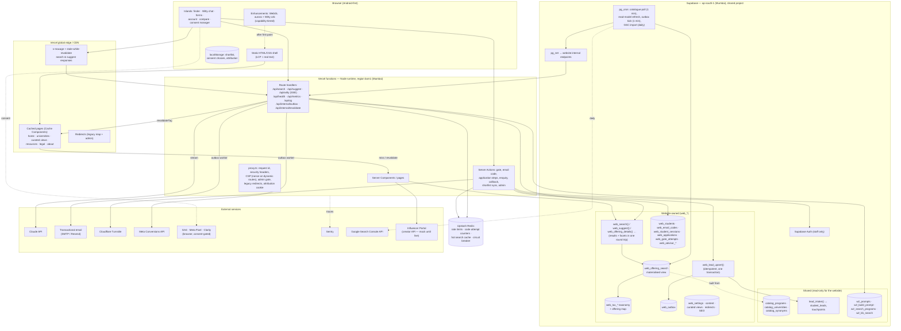

# System architecture

Spec Section 3A. Companion documents: `SCHEMA_PLAN.md` (data), `AGENT_ARCHITECTURE.md` (Witty on the website),
`TECH_DECISIONS.md` (library choices).

## 1. Component and data-flow diagram

## 2. Principles → concrete choices
| Principle (spec 3A) | How it is built |
|---|---|
| Static-first, dynamic where it matters | Pages are Cache Components (`"use cache"` + `cacheLife` + `cacheTag`). Only the finder results, Witty, forms, account and admin are dynamic islands. The homepage hero ships as static HTML; the chat bundle loads on interaction or idle. |
| Co-locate compute with data | `vercel.json` `regions: ["bom1"]`; Supabase in ap-south-1. Static assets from the global edge. |
| Deterministic logic in typed, tested layers | `lib/search/*` (parsing, synonyms, URL state), `lib/eligibility.ts`, `lib/facets.ts`, `lib/attribution.ts`, `lib/consent.ts`, `lib/witty-core/*`, and Postgres functions with SQL tests. Components only render. |
| Never lose a lead | `web_lead_upsert` is synchronous and confirmed (lead id returned before the UI moves on). Everything after it (emails, CAPI, revalidation, notifications) is written to `web_outbox` in the same transaction and processed asynchronously with retries, backoff and a dead-letter state visible in the admin. |
| Graceful degradation | AI down → circuit breaker → guided finder + counselling form. Email provider down → code send fails with a clear message + "Talk to a counsellor on WhatsApp" + the gate attempt is kept. Search function error → browse by level/category. Redis down → Postgres limiter. Analytics blocked → nothing breaks. |

## 3. Read path (finder, panels, university pages)
1. `catalog_*` (shared) → **`web_offering_search`** materialised view joining offerings, the `web_tax_offering_map`,
   university facts (parsed approvals, NAAC, NIRF), editorial profiles (slug, logo permission, state) and derived facts
   (duration). It carries a weighted `tsvector` (`simple` config + `web_normalise`), trigram columns and pre-computed facet
   keys. Allow-listed columns only — never commission or partner fields.
2. **Refresh, never on the request path:** `pg_cron` runs `web_catalog_poll()` every minute; when the catalogue
   fingerprint (max `updated_at`, row count, `w2_meta.catalog_version`) changes it enqueues `web_refresh_jobs`, runs
   `refresh materialized view concurrently web_offering_search`, then calls `/api/internal/revalidate` via `pg_net` with the
   affected tags (`catalog`, `university:<slug>`, `curated:<slug>`). Admin taxonomy edits do the same.
3. **One function per query:** `web_search(p jsonb)` returns results (grouped or flat), facet counts for every facet
   (with the current selection excluded from its own facet — standard faceted search), total, applied filters and
   relaxation suggestions, in a single round trip, called server-side only through the `SearchAdapter`.
4. **Caching:** `/api/search` responses carry `Cache-Control: public, s-maxage=60, stale-while-revalidate=600`, keyed on
   the **normalised** query string (sorted params, lower-cased, defaults removed). Popular queries (from
   `web_popular_searches` and curated views) are pre-warmed after each refresh. Redis holds a 60 s hot cache keyed the same
   way for the server-rendered first page.
5. **Target:** p95 < 150 ms end to end for 10,000 offerings (GIN indexes on the `tsvector` and trigram columns; facet
   counts via `grouping sets` over the filtered set). Verified by the Phase 4 benchmark (synthetic 10k rows) and the
   Phase 12 load test.

## 4. Write path (gate, forms, account)
- All writes are Server Actions or route handlers. The browser never holds a service key; no anon Supabase client is used
  by students.
- Every submit carries an **idempotency key** (UUID generated when the form step is rendered, kept across retries).
  `web_lead_submissions.idempotency_key` is unique, so a retry or double-tap returns the first result.
- Validation: shared zod schemas on client and server; Turnstile verified server-side; rate limits per IP, device and
  email (Redis, sliding window); honeypot; disposable-domain and block lists; junk-risk score.
- Lead creation: `web_lead_upsert` → `lead_intake()` (source_system `web_agent`) in the request; side effects in
  `web_outbox` (same transaction). The outbox worker (`/api/internal/outbox`, kicked by pg_cron + pg_net every minute and
  opportunistically after each write) claims with `for update skip locked`, retries with exponential backoff
  (1 m, 5 m, 30 m, 2 h, 12 h), then marks `dead` (admin can retry).

## 5. Witty (`web_advisor`) path
See `AGENT_ARCHITECTURE.md`. Streaming route `/api/witty` on Node in `bom1`; shared agent core (prompts from
`w2_prompts` by version, Witty's contract in `lib/witty-core`); tools are read-only Postgres functions over the same read
model; state in `web_advisor_sessions`/`web_advisor_messages`; prompt caching, per-session token budget, per-turn
timeout, circuit breaker; metrics: TTFT, total time, tool latency, tokens and cost per conversation, hand-off rate.
Feature flag `web_advisor_enabled` (default off, D-012).

## 6. Identity and sessions
- **Students:** website-owned email codes and an httpOnly, `Secure`, `SameSite=Lax` session cookie (`__Host-eduwit_s`,
  JWT HS256 signed with `WEB_SESSION_SECRET`, 30-day rolling, `sid` checked against `web_student_sessions` on sensitive
  actions so sign-out and deletion revoke immediately). See D-005.
- **Staff:** Supabase Auth (Google or email) + email-code second factor + trusted device (30 days), roles in
  `web_admin_users`; `proxy.ts` gates `/admin`; every admin write goes through audited functions.

## 7. Cross-cutting
- **Key-value store:** Upstash Redis (rate limits, email-code attempt counters, hot search cache, circuit-breaker state)
  behind `KvStore`; in-memory store for dev/test; Postgres fallback limiter.
- **Feature flags and settings:** `web_settings`, read through a `"use cache"` function with `cacheLife({ revalidate: 30 })`
  and tag `settings`; admin saves call `revalidateTag('settings')`.
- **Observability:** `x-request-id` generated in `proxy.ts` (or accepted from Vercel's header) and propagated to logs,
  Sentry spans, DB calls (`set_config('web.request_id', …)` inside functions for logging) and the outbox payload.
  Structured JSON logs (`lib/server/log.ts`) with PII scrubbing. Dashboards: search latency, agent latency, error rates,
  lead funnel (`/api/metrics` + admin).
- **Security headers:** HSTS, `X-Content-Type-Options`, `Referrer-Policy: strict-origin-when-cross-origin`,
  `Permissions-Policy` (camera/mic/geolocation off), `frame-ancestors 'none'`, COOP. CSP: strict allow-list on cached
  pages (`script-src 'self'` + Turnstile + consented analytics hosts, with Next's experimental SRI), nonce-based on dynamic
  routes (account, admin). The exact policy is validated in Phase 2 against a production build.
- **Load targets:** 10,000+ offerings, 1,000 concurrent visitors during ad spikes, 200 concurrent Witty conversations —
  load-tested in Phase 12 (k6-style script with Node, against a production build and the local stack).

## 8. Capability tiers (spec 10.4)
Computed once on the client (`lib/client/tier.ts`) and written to `<html data-tier>` before first paint by a tiny inline
script: **low** if `prefers-reduced-motion`, `Save-Data`, `deviceMemory ≤ 2`, `hardwareConcurrency ≤ 4`, battery saver
(`getBattery().level < 0.2 && !charging`) or no WebGL; **mid** if `deviceMemory ≤ 4`; **high** otherwise. Low = static
gradient poster + CSS-only motion; mid = shader at 0.5× resolution, 30 fps cap; high = 0.75× resolution, 60 fps cap.
Shaders pause when off-screen (IntersectionObserver) or the tab is hidden.

## 9. Environments
| | Local | Preview | Production |
|---|---|---|---|
| App | `next dev` | Vercel preview (protected) | Vercel production (`eduwit.in`) — only after go-live approval |
| DB | Supabase CLI stack (snapshot + seed) and `prod-replica` | local / staging project only | shared production project, read-only until go-live |
| Email | Mailpit | Mailpit-like sink or provider sandbox | provider |
| AI | mock provider unless `ANTHROPIC_API_KEY` | key | key |
