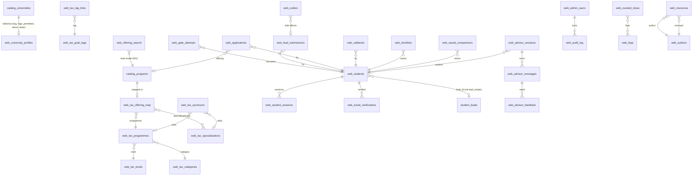

# Schema plan

All website-owned objects live in schema `public` with the `web_` prefix (spec rule 2.1). The schema is already exposed
by PostgREST in production, so no project-wide API setting changes. Defence in depth:
- RLS **enabled on every `web_` table**; no policies for `anon`/`authenticated` (the browser never queries tables);
  `revoke all … from anon, authenticated` on every `web_` table, view, materialised view and function.
- The website server calls `web_*` **functions** with the service role (`security definer`, `set search_path = ''`,
  fully-qualified names). Staff screens are server-rendered and call the same functions after the server has checked the
  staff session + second factor (Phase 10).
- Migrations are additive. Shared objects are never altered in `supabase/migrations/`; proposals live in
  `supabase/migrations-shared/` (dev/replica only) and in `APPROVALS_NEEDED.md`.
- No trigger is added to any shared table (that would alter it). Catalogue changes are detected by polling
  (`catalog_programs`/`catalog_universities` max(`updated_at`) + count + `w2_meta.catalog_version`) every minute.

## 1. ERD (website-owned, simplified)

## 2. Tables

### 2.1 Settings, flags, content (Phases 2, 6, 10)
| Table | Purpose / key columns |
|---|---|
| `web_settings` | `key text pk`, `value jsonb`, `version int`, `updated_at`, `updated_by`. Feature flags (`web_advisor_enabled` default false, `require_phone_otp` false, `push_unverified_gate_leads` false, `document_upload_enabled` false, sections on/off), announcement bar, models, budgets, design concept + default theme, contact numbers, lead writer. Cached at the edge with a short TTL. |
| `web_settings_history` | every previous value (audit + rollback) |
| `web_consent_texts` | `version text pk` (`web-gate-2026-10-v1`), `channel` (gate/form/enquiry), `body`, `purposes text[]`, `active`, `legal_reviewed_at`, `created_at` — versioned, the accepted version is stored with each consent |
| `web_legal_pages` | `slug` (six legal URLs), `title`, `body_blocks jsonb`, `version`, `source` (`legacy_verbatim` / `proposed_edit`), `published_at`, `reviewed_by` |
| `web_pages` | per-path SEO overrides (title, description, OG image, noindex), editorial intro blocks |
| `web_home_sections` | ordered homepage sections with on/off and content blocks |
| `web_testimonials` | name (display, consented), programme, quote, rating?, photo path, `source` (`legacy`/`new`), `published` |
| `web_faqs` | `scope` (global / page path / curated view / university), question, answer blocks, order |
| `web_popular_searches` | label, query string, order, active |
| `web_authors` | named people for bylines (name, role, bio, photo) — spec 13.4 requires a human author + reviewer |
| `web_resources` | `slug`, title, summary, `body_blocks jsonb`, `author_id`, `reviewer_id`, `status` (idea/brief/draft/review/published/refresh_due), `published_at`, `refresh_due_at`, tags, taxonomy links, SEO fields |
| `web_curated_views` | `slug` (e.g. `online-mba`), title, H1, intro blocks, `filters jsonb` (same schema as the finder URL state), FAQs, SEO fields, status |
| `web_redirects` | `from_path` unique, `to_path`, `code` (301/308), `source` (legacy_map/admin/404_monitor), hits, last_hit_at |
| `web_404_log` | path (no query string), referrer host, count, first/last seen (no PII) |
| `web_media` | uploaded image metadata (Storage bucket `web-public`), alt text required |

### 2.2 Taxonomy and catalogue read model (Phase 3)
| Object | Purpose |
|---|---|
| `web_tax_levels`, `web_tax_categories`, `web_tax_programmes`, `web_tax_specialisations`, `web_tax_programme_specialisations`, `web_tax_goal_tags`, `web_tax_career_tags`, `web_tax_tag_links`, `web_tax_synonyms`, `web_tax_mapping_rules` | Canonical taxonomy (see `TAXONOMY_PROPOSAL.md`) |
| `web_tax_offering_map` | `catalog_program_id pk`, `program_key`, `programme_id`, `specialisation_ids int[]`, `format`, `attributes jsonb`, `mapped_by`, `rule_id`, `confidence`, `reviewed_at/by`, `hidden_reason` |
| `web_university_profiles` | `catalog_university_id pk`, `slug unique`, `display_name`, `logo_path`, `logo_permitted bool default false`, `about_blocks`, `state`, `city`, `website_url`, `seo jsonb`, `published` |
| `web_offering_search` (materialised view) | one row per visible offering: catalogue id, program_key, university (id, slug, name, short, logo if permitted, state, type), level, category, programme, specialisation(s), format/attributes, mode, fees (total/yearly/semester/exam/registration, EMI present + amount), derived duration (+source), eligibility (min qualification, min %, work-ex, entrance exam), approvals (UGC-DEB, NAAC grade + rank value, NIRF, AICTE), last verified, popularity, weighted `tsvector` (A: programme/specialisation names + synonyms, B: university names, C: program_name/format, D: eligibility snippets), trigram text columns, facet keys. **Built from an explicit column allow-list; no commission, partner or internal columns.** Unique index on catalogue id for `REFRESH … CONCURRENTLY`. |
| `web_university_facts_v` | parsed NAAC/UGC-DEB/NIRF/AICTE per university with source snippets |
| `web_catalog_state` | last seen catalogue fingerprint; `web_refresh_jobs` queue (refresh + revalidation) |
| `web_search_log` | normalised query, parsed filters, result count, latency, zero-result flag (no PII; free text is stored only after PII scrubbing — emails/phones removed) |

### 2.3 Students, verification, leads (Phase 7)
| Table | Purpose |
|---|---|
| `web_students` | website identity: `id uuid`, `email_norm unique`, `phone_e164`, `full_name`, `lead_id bigint` (from `lead_intake`), `email_verified_at`, `phone_verified_at` (null at launch), `created_at`, `last_seen_at`, `deleted_at` |
| `web_email_codes` | `id`, `email_norm`, `purpose` (gate/form/signin), `code_hash` (sha-256 with per-row salt + server pepper), `expires_at` (10 min), `attempts` (max 5), `sent_at`, `consumed_at`, `ip_hash`, `device_hash` |
| `web_phone_codes` | same shape for the phone-OTP adapter (disabled) |
| `web_email_verifications` | proof of verification per student/lead (what `lead_intake` cannot store yet; A-LEAD-1) |
| `web_student_sessions` | `id` (= JWT `sid`), `student_id`, `created_at`, `expires_at`, `revoked_at`, `ua_hash`, `last_seen_at` |
| `web_gate_attempts` | funnel and drop-offs: `id`, stage timestamps (`opened_at`, `submitted_at`, `code_sent_at`, `verified_at`, `first_message_at`), `email_norm`, `phone_e164`, name, consent version, attribution, `junk_score`, `junk_reasons`, `ip_hash`, `device_hash`, `turnstile_ok`, `pushed_unverified_at` (only if the setting is on), `context` (gate/form/enquiry + offering id) |
| `web_lead_submissions` | `idempotency_key unique`, `student_id`, `kind` (gate, application_step_N, application_submit, enquiry, callback, advisor_turn), request fingerprint, `lead_intake` result jsonb, `created_at` — guarantees exactly-once lead writes |
| `web_applications` | built-in application form: `id`, `reference` (human readable, e.g. `EDW-26-7K3QD`), `student_id`, `lead_id`, `catalog_program_id` (offering) or programme group + `preferred_university_ids`, `steps jsonb` (academic/work/preferences answers, including fields with no lead column), `eligibility_note`, `status` (started/step_N/submitted), timestamps |
| `web_callbacks` | requested slot (date + window), contact mode, status |
| `web_shortlists`, `web_saved_comparisons` | per student; anonymous shortlists live in localStorage and sync on sign-in |
| `web_attribution_touches` | first/last touch per student (UTM, gclid, fbclid, fbp, fbc, referrer host, landing path, creator code) |
| `web_block_list` | `kind` (email/domain/phone/ip_hash), value, reason, expires |
| `web_disposable_domains` | disposable email domains (seeded, editable) |
| `web_rate_events` | Postgres fallback limiter if Redis is unavailable |

### 2.4 Witty on the website (Phase 8) — see `AGENT_ARCHITECTURE.md`
| Table | Purpose |
|---|---|
| `web_advisor_sessions` | session id, student id, lead id, agent-core version (`extractor:v6:<md5>`, `counselor:v6:<md5>`, overlay version, witty-core contract version), Witty-shaped `state jsonb`, classification/readiness/eligibility/phase, tokens in/out/cached, cost (₹/USD micro), timings, `ended_at`, `handoff_at` |
| `web_advisor_messages` | **the `w2_messages` columns** (`id, phone, direction, kind, message_id, run_id, content, answer_mode, reply_source, model, prompt_tokens, cached_tokens, output_tokens, latency_ms, verify_errors, sent, meta, created_at`) **+ `channel` ('web') + `session_id`**, plus `components jsonb` (rendered cards) and `tool_calls jsonb` |
| `web_advisor_feedback` | message id, thumbs up/down, optional reason |

### 2.5 Outbox, analytics, admin, SEO (Phases 2, 9, 10, 11)
| Table | Purpose |
|---|---|
| `web_outbox` | `id`, `kind` (email_confirmation, capi_lead, capi_submit_application, revalidate, notify), `dedupe_key unique`, `payload jsonb` (hashed identifiers only for CAPI), `status` (pending/processing/done/dead), `attempts`, `next_attempt_at`, `last_error`, `created_at`, `processed_at` |
| `web_funnel_events` | server-side funnel counters (gate: hero_view → gate_open → gate_submitted → email_code_sent → email_verified → first_message → qualified; form: panel_open → form_start → step_N → submitted) keyed by anonymous session id, never PII |
| `web_admin_users` | `user_id` (auth.users), `email`, `role` (super_admin / content_editor / viewer), `active` |
| `web_admin_codes`, `web_admin_trusted_devices`, `web_admin_session_checks` | email-code second factor after Google/email sign-in (pattern from `b2c-crm/supabase/migrations/b1_access.sql`) |
| `web_audit_log` | every admin change: actor, action, table, record id, before/after (PII-redacted), at |
| `web_seo_gsc_daily` | date, page, query, clicks, impressions, ctr, position (Search Console) |
| `web_seo_keywords` | keyword, priority, target page, notes |
| `web_seo_page_checks` | path, score, issues jsonb, checked_at |
| `web_seo_link_suggestions` | from resource → to curated view / university, status (suggested/accepted/rejected) |
| `web_seo_tasks` | local SEO / GBP checklist items with status |

## 3. Functions (all `web_*`, security definer, `search_path = ''`, service role only)
- **Read model:** `web_search(p jsonb)` → `{results|groups, facets, total, applied, relaxations}` in one call;
  `web_suggest(p_q text)` → grouped suggestions (programmes, specialisations, universities, guides);
  `web_offering_details(p_id)`, `web_programme_group(p jsonb)`, `web_compare_offerings(p_ids int[])`,
  `web_university_details(p_slug)`, `web_catalog_stats()` (live trust-line numbers), `web_refresh_read_model()`,
  `web_catalog_poll()` (detect changes → enqueue refresh + revalidation).
- **Taxonomy:** `web_tax_automap(p_dry_run bool)`, `web_tax_unmapped()`, `web_tax_set_mapping(p jsonb)`,
  `web_data_quality()`.
- **Students and leads:** `web_email_code_issue(p jsonb)`, `web_email_code_verify(p jsonb)`,
  `web_session_create/check/revoke`, `web_lead_upsert(p jsonb)` (§4), `web_application_save_step(p jsonb)`,
  `web_application_submit(p jsonb)`, `web_callback_request(p jsonb)`, `web_gate_attempt_*`.
- **Agent:** `web_agent_core_prompts()` (reads `w2_build_prompt('extractor'|'counselor')` + versions/md5),
  `web_advisor_turn_save(p jsonb)`, `web_advisor_session_*`.
- **Outbox:** `web_outbox_claim(p_limit)` (`for update skip locked`), `web_outbox_done(p_id)`,
  `web_outbox_fail(p_id, p_error)` (exponential backoff, dead after N), `web_outbox_retry(p_id)` (admin).
- **Admin / SEO:** CRUD functions with audit logging; `web_seo_*` ingestion and reports.
- **Health:** `web_health()` → db round-trip, read-model freshness, outbox backlog/dead count.

## 4. Leads — the approved path (D-009)
`web_lead_upsert(p jsonb)` runs in one transaction:
1. Idempotency: insert into `web_lead_submissions(idempotency_key)`; on conflict return the stored result.
2. Build the `lead_intake` payload (below) and call **`public.lead_intake(...)`** with `source_system = 'web_agent'`.
3. Link `web_students.lead_id`, record `web_email_verifications`, store form extras in `web_applications`.
4. Insert side effects into `web_outbox` (confirmation email, CAPI `Lead`/`SubmitApplication`, notifications).

Duplicate handling is `lead_intake`'s own (match on normalised phone via `crm_find_lead`; created / merged / reopened).
An existing student (same email or phone) re-uses the lead; the website never inserts into `student_leads` directly.

### 4.1 Field mapping (website → `lead_intake` `lead` keys → `student_leads` column)
| Website field | `lead` key | Column | Notes |
|---|---|---|---|
| Full name | `full_name`, `is_name_confirmed: true` | student_name, name_confirmed | typed by the student |
| Phone (+91, validated, E.164) | top-level `phone` | whatsapp_number | **not** OTP-verified; `phone_verified_at` stays null |
| Email (verified by code) | `email`, `is_email_confirmed: true` | email_id, email_confirmed | `email_verified_at` needs A-LEAD-1; kept in `web_email_verifications` |
| Programme / specialisation / university (from offering) | `interested_course`, `interested_specialization`, `interested_university`, `programme_level`, `study_mode_preference` | same | canonical display names from the taxonomy |
| Highest qualification (+ stream) | `highest_qualification` | same | e.g. "Graduation — B.Com" (Witty uses free text too) |
| Currently studying | `current_study` | same | |
| % / CGPA | `academic_score_raw`, `academic_score_pct` | academic_percentage_gpa, academic_score_pct | CGPA converted only with an explicit scale |
| Year of passing, board/university, industry, "why this programme", EMI interest, questions | — | — | `web_applications.steps` (no column; listed in A-LEAD-2 handoff) |
| Working + years | `work_experience_raw`, `work_experience_years_num` | work_experience_years, …_num | |
| Current role | `current_job_role` | same | |
| Career goal (goal tag) | `primary_motivation` | same | tag label |
| Preferred intake | `enrollment_timeline` | same | |
| Budget range | `annual_budget_raw`, `annual_budget_inr` | annual_budget, annual_budget_inr | |
| Preferred universities | `university_preference` | same | comma-separated names |
| City / state | `city`, `state`, `location_raw` | city, state, current_city_country | |
| Contact mode + best time | `preferred_call_time` | preferred_counseling_time | "WhatsApp, evenings" |
| Application submitted | `last_intent: "wants_to_apply"` | intent_type | event_type `lead.application_requested`; reference in `web_applications` |
| Source | `source` | lead_source | `website_agent` (Witty gate) · `website_form` (application/enquiry forms) |
| Channel | `channel: "web"` (Witty gate/advisor) · `"web_form"` (forms); `first_agent_channel: "web"` (advisor only) | channel, first_agent_channel | first-touch fields; matches the B2B `web_form` channel classification |
| Website session | `web_session_id` | same | lets the CRMs recognise web leads |
| UTM / click IDs / landing / referrer | `utm_*`, `click_ids` {gclid, gbraid, wbraid, fbclid, fbc, fbp}, `landing_url`, `referrer_url` | same | first-touch only |
| Creator code | `referred_by_code` (influencer code, as Witty sends it) | referred_by_code | never gates access |
| Consent | `consent_sales_at`, `consent_partner_share_at`, `consent_text_version`, `consent_marketing_at` (only if the optional box is ticked) | same | write-once |
| Device type | `device_type` | device | no IP address is sent (data minimisation) |
| Witty classification (advisor only) | `classification`, `readiness`, `eligibility`, `conversation_phase`, `last_intent` | lead_status, admission_readiness, eligibility_status, lead_stage, intent_type | produced by `witty-core`, same enums as Witty |

## 5. Proposed shared changes (dev only; see `APPROVALS_NEEDED.md`)
- `migrations-shared/s01_lead_intake_email_verified.sql` — A-LEAD-1 and A-LEAD-2 (allow-list additions).
- `migrations-shared/s02_w2_messages_channel.sql` — A-AGENT-2/3.
- `migrations-shared/s03_shared_taxonomy.sql` — A-TAX-1 (rename `web_tax_*` → `catalog_tax_*` + compatibility views).
- B2B settings change A-B2B-1 and consent registration A-CONSENT-1 are admin actions (documented, no migration).

## 6. Test strategy for the schema
- Every migration applies cleanly on (a) a fresh local database (`supabase db reset`: prod snapshot + website migrations
  + seed) and (b) `prod-replica` (full production schema rebuilt from production's migration history).
- SQL tests in `supabase/tests/` (run inside `begin … rollback`): RLS denies `anon`/`authenticated` on every `web_` table
  (generated check over `pg_class`), function grants (service role only), `web_lead_upsert` idempotency and duplicate
  handling through the real `lead_intake`, outbox claim/backoff, read-model column allow-list (no banned columns), search
  quality fixtures.
